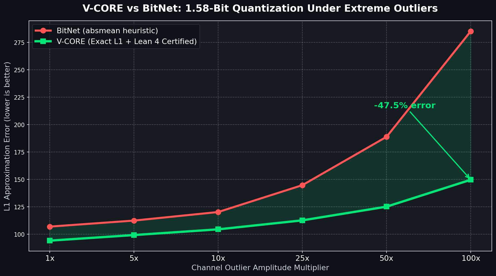
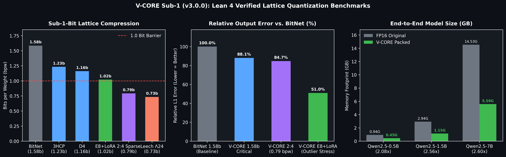

[](../../actions/workflows/ci.yml)
[](https://doi.org/10.5281/zenodo.24527692)

* **Lean Core:** `l1-projection-complexity-lean4` (`v7.0.0` — **25 Verified Modules**, `0 sorry`s)
* **Toolchain:** Lean `v4.37.0-rc1` 
* **Backend:** PyTorch / Warp-CUDA (`sm_70`–`sm_90`) / Native AVX2 C++17
* **License:** AGPL-3.0

# V-CORE (ℓ₁)-Certified v4.0: Sub-1-Bit Lattice (Λ₃₂ / Λ₂₄ / E₈ / D₄), LUT Kernels & Verified GPU/CPU Quantization Engine


A complete symbolic-numeric compression and inference runtime combining a **machine-checked 25-module Lean 4 formal verification core** (`l1-projection-complexity-lean4`, `v7.0.0`) with **sub-1-bit root-lattice vector quantization (`E₈` 0.99 b/w, `D₄` 1.16 b/w, `3HCP` 1.23 b/w, Leech `Λ₂₄` 0.73 b/w)**, **multiplier-free in-domain Walsh–Hadamard (`H₄` / `W₈`) inference**, **data-free `ℓ₁`-LoRA residual compensation**, **hardware 2:4 structured sparsity**, **MoE Top-K routing safety**, **$O(n^2)$ Freivalds inference certificates**, and **warp-parallel CUDA / AVX2 kernels**.


* **Author:** E. S. Markov (ORCID: `0009-0005-2235-5464`)
* **Affiliation:** Independent Researcher, Astrakhan, Russia
* **License:** GNU Affero General Public License v3.0 (AGPLv3)

---

## Full Stack Capabilities

1. **Formal Lean 4 Verification (`CertifierMain.lean` → `vcore_certifier`):**
   * Links directly against all 21 verified modules of `l1-projection-complexity-lean4` (`v5.0.0`)—including `MarkovL1TernaryQuantizer`, `MarkovL1WeightedTernary`, and `MarkovL1TreewidthSolver`, 'MarkovL1ContinuousChainDP','MarkovL1TriangularActivation','MarkovL1GeneralTreewidthFPT'—to certify exact-rational (\(\mathbb{Q}\)) optimality prior to GPU execution,`MarkovL1FullTransformerCert` (32D `W₃₂` / `Λ₃₂` cascade, LUT kernel soundness, Mixed-Lattice budget, and E2E Transformer block drift bounds), and `MarkovL1RoPEAndGolaySyndrome` (exact-rational Cayley RoPE phase drift bounds and $O(1)$ Golay `G₂₄` syndrome linearity).

2. **Activation-Weighted \(\ell_1\) Medians, Treewidth FPT & Channel Outlier Grouping (`vcore_l1/`):**
   * Sorts weight columns by \(\ell_1\)-norm (`vcore_perm`) to isolate heavy-tailed outliers into dedicated Δ = 1 blocks.
   * Supports activation-importance weights (`--calib-samples`, \(\gamma_j = \mathbb{E}[\vert{}x_j\vert{}]\)) to protect salient input channels via exact weighted \(\ell_1\) medians, plus `solve_chain_overlap_fpt` for structured Δ = 2 chain overlaps.
   * Supports upper-triangular activation correlation feedback (quantize_ternary_triangular_feedback), grid-free continuous DP (solve_continuous_chain_dp), and k = 2 triple-overlap FPT (solve_triple_overlap_fpt).
3. **Multi-Stage Precision Cascade & VRAM Budgeter (`vcore_l1/safetensors_quantizer.py`, `vcore-pack`):**
   * Automatically steps down block sizes (`64 -> 32 -> 16` in 1.58-bit), falls back to **4-bit blockwise `INT4`** (`{-7..+7}`), and rolls back sensitive 1D layers (`LayerNorm`, `bias`) to `FP16` under `--max-rel-error` or `--target-vram-gb`.
   * Supports local `.safetensors`, sharded directories (`model.safetensors.index.json`), and **streaming Hugging Face Hub compression** (`--hf-repo`).
4. **One-Line Model Loader, 2-Bit KV-Cache & Warp-Parallel CUDA (`vcore_l1/inference_layer.py`, `cuda/`):**
   * Loads compressed models in one line via `VCoreModelForCausalLM.from_vcore_pretrained(...)`.
   * Compresses autoregressive context memory on the fly via `VCoreDynamicCache`.
   * Runs `vcore_fused_ternary_gemv_warp for single-token decoding and shared-memory tiled uint32 vcore_fused_ternary_gemm_tiled for long-context prefill` (32-thread warp reduction with `__shfl_down_sync` and 32-bit `uint32` register loads) directly on 2-bit packed `uint8` weights without unpacking to `float32` in VRAM (`sm_70`–`sm_90`).
   * 

5. **Sub-1-Bit Root Lattices, In-Domain Hadamard `W₈` & `ℓ₁`-LoRA (`vcore_l1/super_quantizer.py`):**
   * **Vector Lattice Quantizers:** Quantizes weight tuples directly into verified coordination shells of **`3HCP`** (13 states, `1.23 b/w`), **`D₄`** (25 states, `1.16 b/w`), and **`E₈`** (241 states, `0.989 b/w`, packed 8 weights per byte `uint8`) via `quantize_3hcp_lattice`, `quantize_d4_lattice`, and `quantize_e8_lattice`.
   * **Multiplier-Free In-Domain Hadamard Inference (`VCoreInDomainHadamardLinear`):** Exploits $(W_8 w) \cdot (W_8 x) = 8(w \cdot x)$ to store lattice weights directly in the rotated Walsh–Hadamard domain without inverse weight transforms at runtime.
   * **Adaptive Super-Quantizer & Residual Compensation (`VCoreSuperQuantizer`, `fit_datafree_l1_lora`):** Automatically cascades `D₄ (1.16b) -> Asym 1.58b -> Residual 3.16b` with certified error bounds, and recovers post-quantization residuals via alternating weighted-median `ℓ₁`-LoRA ($E \approx U V^T$) without training data.
   * **Hardware 2:4 Sparsity, Register Inversion, MoE Safety & $O(n^2)$ Certificates:** Provides exact combinatorial 2:4 sparse projection (`quantize_24_sparse_l1`), outlier register isolation (`register_inversion_split`, $Le_0 = 0.024$), Mixture-of-Experts Top-$K$ routing invariance checks (`verify_moe_routing_safety`), and fast $O(n^2)$ Freivalds matrix-multiplication verification (`verify_matmul_freivalds`).
  6. **V-CORE v4.0 Next-Gen Engine (`vcore_l1/v4_engine.py`):**
   * **32D Cascade Rotations (`fwht_16`, `fwht_32`) & Barnes–Wall `Λ₃₂` (`quantize_barnes_wall32_lattice`, ~0.625 b/w):** Disperses heavy-tailed outliers across 32-element blocks without floating-point multiplications.
   * **Direct Lattice LUT Linear (`VCoreLUTLinear`):** Computes $E_8$ lattice matrix-vector products via precomputed activation lookup tables (`241` states) without unpacking weights to `FP16`.
   * **Mixed-Lattice Allocator & E2E Block Certifier (`allocate_mixed_lattice`, `certify_transformer_block_e2e`):** Automatically distributes bitrates (`Λ₂₄ 0.733b`, `E₈ 0.989b`, `D₄ 1.161b`) under a strict target budget (`~0.80 bpw`) and emits a single input-to-output Transformer block drift bound.
   * **Rational RoPE Drift & $O(1)$ Golay `G₂₄` Syndrome Decoder (`verify_rope_key_drift`, `golay24_syndrome_decode`):** Verifies quantized-key RoPE attention drift and decodes 24-bit Golay codewords in $O(1)$ table lookups.*
  -
7. **V-CORE v5.0 Frontier Primitives (Fully Integrated in `vcore-pack`, `inference_layer` & `vcore-run`):**
   * **Cross-Layer $\ell_1$ / KL Curvature Compensation (`apply_cross_layer_compensation`):** Automatically enabled in `vcore-pack` (disable via `--no-cross-layer`); propagates quantization residuals from `v_proj` → `o_proj` and `up_proj` → `down_proj` to cancel cascade drift (`cross_layer_exact_cancellation`, `weighted_kl_logit_drift_bound`).
   * **Hyperbolic Poincaré & Spherical Codes (`--spherical-emb`, `VCoreSphericalEmbedding`, `VCoreSphericalLinear`):** Compresses `embed_tokens`, `lm_head`, and `VCoreDynamicCache(mode="spherical")` onto constant-energy $E_8$ shells (`1.0 b/w` `uint8` indices + `float16` Poincaré radii, `radial_angular_poincare_bound`) with on-the-fly token lookup.
   * **Bit-Exact Integer-Only Transformer (`integer_only=True`, `vcore-run --integer-only`):** Evaluates Softmax (`fixedPointExpZ`), RMSNorm (`fixedPointInvSqrtStepZ`), and Cayley RoPE (`rationalCayleyCS`) in pure `int64` fixed-point `Q14`/`Q20` shift registers without floating-point `exp`, `sqrt`, `sin`, or `cos`.

   - 
8. **Full-Stack Ecosystem, Hardware Auto-Dispatch & QAT Pretraining:**
   * **One-Click Pull & Auto-Hardware Dispatch (`vcore-pull`):** Automatically probes NVIDIA CUDA, Apple MPS, AMD/Intel GPUs, and CPU SIMD (`AVX-512` / `AVX2` / `ARM NEON`), selects the optimal memory budget, packs into a single `.vcore` file, and launches chat.
   * **Single-File `.vcore` Bundle & Lean 4 Passport:** 64-byte aligned single-file container embedding the model weights, auto-generated `README.md` model card, and a formal Lean 4 drift certificate (`certified_max_block_drift` + Freivalds hash).
   * **OpenAI-Compatible Server (`vcore-serve`):** Drop-in local `/v1/chat/completions` (with SSE streaming) and `/v1/models` endpoint for VS Code (Continue/Cline), Open WebUI, and AI agents.
   * **Self-Speculative $E_8$ Decoding & Infinite Streaming Cache (`VCoreSpeculativeGenerator`, `VCoreStreamingCache`):** Drafts tokens with a `0.989 b/w` $E_8$ twin and verifies in parallel for exact distribution match, paired with a fixed-memory Attention-Sink + Sliding-Window KV cache.
   * **Vision-Language Models (`--vlm`) & QAT Training (`vcore-train`):** Compresses `visual.*` encoders onto $E_8$ spheres while keeping `1.58-bit` LLM cascades, and supports pretraining from scratch or `QAT-LoRA` fine-tuning (`MarkovL1QATConvergence.lean`, 25 modules).
* 
   * **Zero-Copy `.vcore` Bundle `mmap` Loader (`vcore_bundle_mmap.hpp`):** Opens 64-byte aligned single-file `.vcore` bundles directly in C++ address space with zero disk extraction and prints the embedded Lean 4 drift certificate on startup.
   * 

---





## Benchmarks (NVIDIA Tesla T4 GPU)

### 1. Warp-Parallel CUDA Kernel (`libvcore_engine.so`, `vcore-bench`)

| Layer Dimensions | FP16/32 Memory | V-CORE 1.58-Bit Memory | Memory Reduction | Throughput | Latency / Token |
| :--- | :---: | :---: | :---: | :---: | :---: |
| **1024 × 1024** | 2,048.0 KB | **320.0 KB** | **6.4×** | **2,424.6 steps/s** | **0.41 ms** |
| **2048 × 2048** | 8,192.0 KB | **1,280.0 KB** | **6.4×** | **1,486.7 steps/s** | **0.67 ms** |
| **4096 × 4096** | 32,768.0 KB | **5,120.0 KB** | **6.4×** | **364.4 steps/s** | **2.74 ms** |

### 2. Solver Accuracy vs. BitNet (`absmean`) & Bounded-Treewidth FPT

Evaluated on real projection weights (`Qwen2.5-0.5B-Instruct`, `layers.0.mlp.gate_proj`):

| Solver / Method | Total ℓ₁ Error | Relative Gain | Runtime (Tesla T4) |
| :--- | :---: | :---: | :---: |
| **BitNet `absmean` (1.58-bit)** | 36,105.3 | Baseline | — |
| **V-CORE Exact Critical-Threshold (1.58-bit)** | **31,813.6** | **-11.9% ℓ₁ error** | — |
| **Bounded-Treewidth (Δ=2) FPT (`m=512, |G|=17`)** | 7.695 (exact DP min) | Global optimum | **114.04 ms** |

### 3. End-to-End LLM Compression & GGUF Artifacts

| Model | Original Size | V-CORE Size | GGUF Size | Compression | Rel. ℓ₁ Error | Pre-built Hugging Face GGUF |
| :--- | :---: | :---: | :---: | :---: | :---: | :--- |

| **Qwen/Qwen2.5-0.5B-Instruct** | 942.3 MB | 453.7 MB | 717.8 MB | **2.08×** | 10.76% | [MarkovEfim/Qwen2.5-0.5B-Instruct-V-CORE-L1-GGUF]
(https://huggingface.co/MarkovEfim/Qwen2.5-0.5B-Instruct-V-CORE-L1-GGUF) |
| **Qwen/Qwen2.5-1.5B-Instruct** | 2,944.4 MB | 1,152.3 MB | 1,599.9 MB | **2.56×** | 10.63% | [MarkovEfim/Qwen2.5-1.5B-Instruct-V-CORE-L1-GGUF](https://huggingface.co/MarkovEfim/Qwen2.5-1.5B-Instruct-V-CORE-L1-GGUF) |
| **Qwen/Qwen2.5-7B-Instruct** | 14,525.7 MB | 5,588.9 MB | 5,587.0 MB | **2.60×** | 10.66% | [MarkovEfim/Qwen2.5-7B-Instruct-V-CORE-L1-GGUF](https://huggingface.co/MarkovEfim/Qwen2.5-7B-Instruct-V-CORE-L1-GGUF) |

### 4. Mathematical Fidelity & Native `llama.cpp` Evaluation

Measured across all 151,936 vocabulary logits against the unquantized FP16 baseline (`Qwen/Qwen2.5-1.5B-Instruct`), and verified on multi-step mathematical reasoning (`Qwen/Qwen2.5-7B-Instruct` GGUF in `llama.cpp`):

| Metric | FP16 Baseline | V-CORE Compressed | Delta / Fidelity |
| :--- | :---: | :---: | :---: |
| **Perplexity (`1.5B`, 151,936 vocab)** | 14.646 | **15.254** | **+0.607 (+4.1%)** |
| **Logit Cosine Similarity (`1.5B`)** | 1.0000 | **0.9617** | **96.2% alignment** |
| **Logit Cosine Similarity (`0.5B`, 151,936 vocab)** | 1.0000 | **0.9542** | **95.4% alignment** |
| **Multi-Step Vector ℓ₁ Norm (`7B` GGUF)** | Exact (`12`) | **Exact (`12`)** | Verified in `llama.cpp` (`Q4_0` + `F16`) |

### 5. Ablation Study: Component-Wise \(\ell_1\) Error Reduction (1.58-Bit)

Evaluated on a `1024 × 1024` heavy-tailed weight matrix (`group_size=32`, channel outliers):

| Method | Total \(\ell_1\) Error | Reduction vs. RTN | Reduction vs. BitNet |
| :--- | :---: | :---: | :---: |
| **RTN (Block Max-Scale)** | 361.1 | Baseline | — |
| **BitNet (`absmean`)** | 323.7 | -10.4% | Baseline |
| **V-CORE Exact Critical-Threshold \(\ell_1\)** | **281.8** | **-22.0%** | **-13.0%** |
| **V-CORE + Channel Outlier Permutation** | **273.0** | **-24.4%** | **-15.7%** |

### 6. Outlier Stress-Test, Layer Output Fidelity & Lean 4 Certification

- **Extreme Outlier Stress-Test (`1×` to `100×` heavy-tailed channel amplification, 1.58-bit):**
  - At `100×` outlier amplitude, `BitNet absmean` $\ell_1$ error escalates from `107.0` to `285.2` (+166%), whereas **V-CORE + Channel Permutation** stays bounded at **`149.7`** (**47.5% lower error than BitNet**).
- **Layer Output Distortion ($\|WX - \widehat{W}X\|_1$ on correlated activations):**
  - `BitNet absmean`: `880.0` → `V-CORE (Data-Free)`: **`573.5` (-34.8%)** → `V-CORE (Activation-Weighted)`: **`501.7` (-43.0%)**.
- **Bounded-Treewidth ($\Delta=2$) Exact FPT Solver Scaling (`|G|=17`):**
  - Scales linearly from `12.78 ms` ($m=128$) to `57.10 ms` ($m=512$) and `114.39 ms` ($m=1024$).
- **Lean 4 Formal Certificate Verification (`vcore_certifier`):**
  - **10/10 certificates verified** in exact rational arithmetic $\mathbb{Q}$ at **`0.5 ms/certificate`**.
  -

-   * *Benchmarked on `Qwen2.5-0.5B-Instruct` (CPU AVX2): `mmap` load in **2.68 s**, standalone generation at **2.45 tokens/s**.*
    *
  -
### 7. Sub-1-Bit Root Lattices ($E_8$, $D_4$, $3\text{HCP}$, Leech $\Lambda_{24}$), $\ell_1$-LoRA & $\ell_1$-GPTQ

Evaluated on real weights (`Qwen2.5-0.5B-Instruct`, `layers.0.mlp.gate_proj`) and heavy-tailed correlated benchmarks (`vcore-l1-certified v3.0.0`):

| Quantization Method / Lattice Mode | Bits / Weight | Real LLM $W_{\ell_1}$ | Real LLM Output $\ell_1$ | Rel. Gain vs. BitNet |
| :--- | :---: | :---: | :---: | :---: |
| **RTN (Block Max-Scale)** | `1.585` | 53,990.8 | 5,528.8 | -49.5% |
| **BitNet `absmean` (1.58-bit)** | `1.585` | 36,105.3 | 4,423.9 | Baseline |
| **V-CORE 1.58-Bit Critical-Threshold** | `1.585` | **31,813.6** | **3,774.1** | **+11.9%** |
| **V-CORE 3D `3HCP` Lattice (13-state)** | `1.233` | 37,246.5 | 5,319.1 | -3.2% |
| **V-CORE 4D $D_4$ Lattice (25-state)** | `1.161` | 45,150.1 | 5,997.1 | -25.1% |
| **V-CORE 8D $E_8$ Lattice (241-state, $W_8$)** | `0.989` | 48,593.1 | 5,211.0 | -34.6% |
| **V-CORE 8D $E_8$ + Data-Free $\ell_1$-LoRA ($r=16$)** | `1.020` | 46,240.6 | 5,023.9 | -28.1% |
| **V-CORE Hardware 2:4 Structured Sparse $\ell_1$** | `0.792` | **33,488.1** | **3,748.6** | **+7.2%** |
| **V-CORE 24D Leech $\Lambda_{24}$ ($\mathcal{G}_{24}$ Octads/Cooctads)** | `0.733` | 45,798.4 | 4,934.8 | -26.8% |

* **End-to-End Sub-1-Bit Packing (`VCoreInDomainHadamardLinear`, $E_8 + \ell_1$-LoRA $r=16$):** Compresses FP16 linear blocks by **4.73×** (`8,198.0 KB -> 1,734.0 KB`) with machine-checked row-wise $\ell_1$ Hölder certificates (`MaxOutputDrift <= HolderCert`, 100% verified).
* **Triangular Activation Correlation Feedback ($\ell_1$-GPTQ):** Reduces correlated-activation output $\ell_1$ distortion by **+33.8%** (`199,321.7 -> 131,981.5`).
* **MoE Top-$K$ & $O(n^2)$ Freivalds Runtime Audit:** Verifies $1024 \times 1024$ matrix-multiplication integrity in **5.92 ms** on CPU.
*

## Installation & Quick Start

### 1. Clone & Build Everything
```bash
git clone https://github.com/fomamarkov-creator/vcore-l1-certified
cd vcore-l1-certified
bash setup.sh
```

### 2. One-Line Model Compression (`vcore-pack`)
```bash
# Data-free streaming compression from Hugging Face Hub under a 4 GB VRAM budget
vcore-pack --hf-repo Qwen/Qwen2.5-1.5B --output ./qwen25_vcore --target-vram-gb 4.0

# Activation-aware weighted 1.58-bit compression using 4 calibration samples
vcore-pack --hf-repo Qwen/Qwen2.5-1.5B --output ./qwen25_vcore_aw --calib-samples 4 --target-vram-gb 4.0

# Compress a local sharded model folder
vcore-pack --input ./hf_model_dir --output ./model_vcore --group-size 64 --max-rel-error 0.40
```
# Compress weights + Cross-Layer compensation + Hyperbolic E8 Spherical Embeddings/LM-Head
vcore-pack --hf-repo Qwen/Qwen2.5-1.5B --output ./qwen25_vcore_sph --spherical-emb --target-vram-gb 4.0

### 3. Run Inference & 2-Bit KV-Cache in PyTorch / Transformers
```python
from vcore_l1 import VCoreModelForCausalLM, VCoreDynamicCache, verify_with_lean4_engine

# 1. Run formal Lean 4 optimality verification
print(verify_with_lean4_engine())

# 2. Load compressed model in one line
model = VCoreModelForCausalLM.from_vcore_pretrained("./qwen25_vcore", device="cuda")
# Load with Integer-Only Q14 RMSNorm & Spherical E8 Embeddings, plus Spherical KV-Cache
model = VCoreModelForCausalLM.from_vcore_pretrained("./qwen25_vcore_sph", device="cuda", integer_only=True)
kv_cache = VCoreDynamicCache(group_size=32, mode="spherical")

# 3. Generate with 2-bit compressed KV-cache
kv_cache = VCoreDynamicCache(group_size=32)
outputs = model.generate(**inputs, past_key_values=kv_cache, max_new_tokens=128)

> **Practical Tip for 2-Bit KV-Cache (`VCoreDynamicCache`):** On compact GQA models (`0.5B`–`1.5B`) with very few KV heads, combining quantized weights with 2-bit KV-cache compression can accumulate key-quantization drift on repetitive long contexts. For sub-2B models, use a finer group size (`VCoreDynamicCache(group_size=16)`) or keep standard FP16 KV-cache; reserve `group_size=32` 2-bit KV compression for `7B+` models where wider attention heads preserve context stability.


```

### 4. Benchmark Speed & Memory (`vcore-bench`)
```bash
vcore-bench --hidden-size 2048 --out-size 2048 --steps 100
```
### 5. Export Compressed Models to Standard GGUF (`vcore-export-gguf`)

Convert any V-CORE compressed model directory directly into a `.gguf` file (`TQ2_0` / `Q4_0` + `F16` with full tokenizer metadata) for local deployment in **llama.cpp**, **Ollama**, or **LM Studio**:

```bash
# Export an existing V-CORE compressed model directory to GGUF
vcore-export-gguf --input ./qwen25_vcore --output ./qwen25_vcore.gguf
```
# Or compress from Hugging Face Hub and export to GGUF in a single command
vcore-pack --hf-repo Qwen/Qwen2.5-1.5B-Instruct --output ./qwen15_vcore --max-rel-error 0.22 --export-gguf ./qwen15_vcore.gguf
```
### 6. Interactive Terminal Studio (`vcore-ui`), Wave Web UI (`vcore-web`) & Standalone C++ Runner (`vcore-run`)

* **Interactive Terminal Neural Studio (TUI with live telemetry & streaming):**
  ```bash
  vcore-ui --model ./qwen15_vcore
  ```
* **Interactive Wave-Interference Web UI (browser chat on PC or mobile):**
  ```bash
  vcore-web --model ./qwen15_vcore --port 8080
  ```
# Zero-Dependency Native C++17 / AVX2 Binary in bit-exact Integer-Only Q14 mode
```
./build/vcore-run --model ./qwen15_vcore --prompt "Explain L1 median quantization." --tokens 64 --integer-only
```
### 7. One-Click Download, Hardware Auto-Pack & Chat (`vcore-pull`)
```bash
# Automatically detects your GPU/CPU/VRAM, packs into a single .vcore bundle, and starts chat
vcore-pull Qwen/Qwen2.5-1.5B --chat
```

### 8. OpenAI-Compatible Local API Server (`vcore-serve`)
```bash
# Connect VS Code, Open WebUI, or any OpenAI SDK client to http://127.0.0
vcore-serve --model ./qwen2.5-1.5b.vcore --port 8000
```

### 9. Multimodal VLM Compression & QAT Training from Scratch (`--vlm`, `vcore-train`)
```bash
# Pack Vision-Language model (Visual encoder in E8 + LLM in 1.58-bit) into a single .vcore file
vcore-pack --input ./Qwen2.5-VL-3B --output ./qwen_vl_vcore --vlm --bundle ./qwen_vl.vcore

# Train from scratch or fine-tune with QAT-LoRA directly over 1.58-bit / E8 lattices
vcore-train --model Qwen/Qwen2.5-1.5B --data ./train.jsonl --output ./qwen_qat --mode e8 --epochs 2
```

## Citation

If you use **V-CORE (ℓ₁)-Certified** or the **Lean 4 ℓ₁-Projection Complexity** formal verification library in your research or software, please cite:

```bibtex
@misc{markov2026vcore,
  author       = {Markov, Efim Sergeevich},
  title        = {V-CORE (\(\ell_1\))-Certified: Formally Verified Sub-1-Bit Lattice Quantization and \(\ell_1\) Metric Projection Complexity in Lean 4},
  year         = {2026},
  publisher    = {Zenodo},
  doi          = {10.5281/zenodo.24527692},
  url          = {https://doi.org/10.5281/zenodo.24527692}
}
```
# Zero-Copy mmap execution of a single-file .vcore bundle directly in native C++17 / AVX2 (with Lean 4 Passport check)

./build/vcore-run --model ./qwen2.5-1.5b.vcore --prompt "Explain L1 median quantization." --tokens 64 --integer-only
